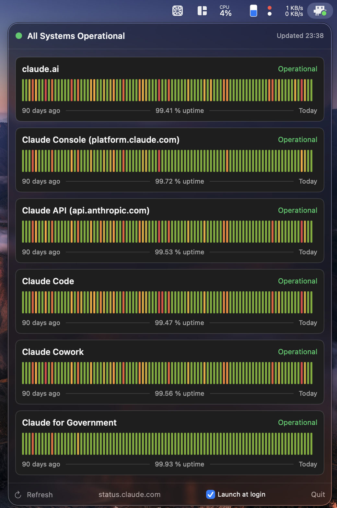

# ClaudeStatus

A macOS menu bar app that tracks [status.claude.com](https://status.claude.com).



The menu bar shows Clawd (the Claude Code mascot) with a status dot that reacts
to the claude.ai and Claude Code components: green when operational, orange when
degraded, red on a major outage, gray when the status page is unreachable.
Clicking the icon opens a panel with one card per service: current status, the
90-day uptime bars from the status page (with hover tooltips for incidents),
and the uptime percentage.

Live status comes from the official Statuspage API (polled every 90 seconds);
the 90-day history is parsed from the status page's homepage uptime section, since no
public API exposes that window. If the page's markup changes, the app degrades
to status-only cards rather than breaking.

## Requirements

- macOS 14 or later
- Xcode Command Line Tools (`xcode-select --install`); no full Xcode needed

## Setup

```
make install
```

This builds the app, assembles a signed `.app` bundle, copies it to
`~/Applications`, and launches it. Enable "Launch at login" from the panel's
footer if you want it to persist. Use `make run` instead to build and launch
without installing.

## Development

```
make run       # build, assemble the bundle, launch
make check     # selftest: parser regression checks against the live site
make fixtures  # download homepage + summary JSON into fixtures/
make check FIXTURE=fixtures/homepage.html   # selftest offline, against the fixture
```

Run `make check` after touching the parsing layer. See `CLAUDE.md` for
architecture notes and testing hooks (forcing icon states, pointing the app at
a mock server).
